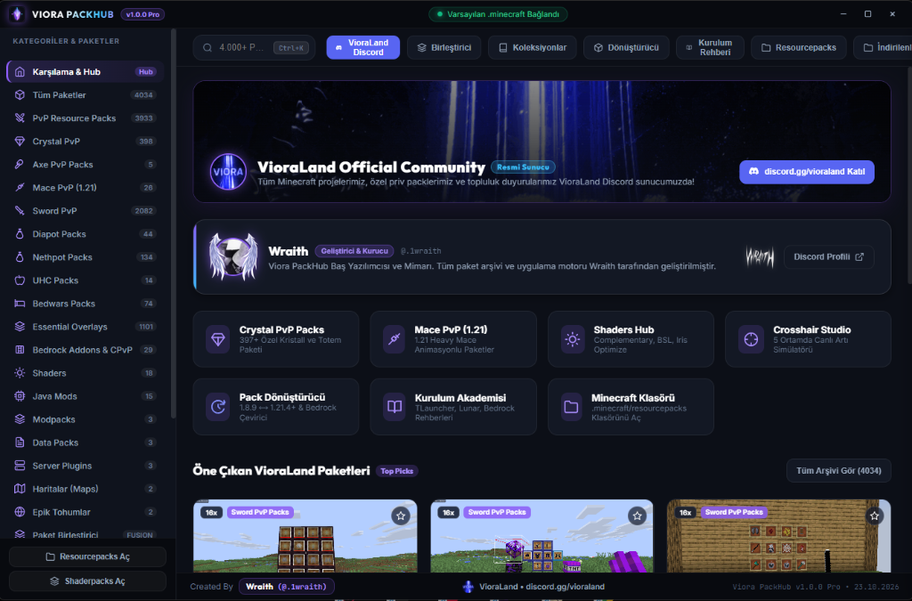

  

  # ⚡ VIORA PACKHUB
  ### *The Ultimate Minecraft Resource Pack, Shaders, Mods, Clients & Tools Hub*

  
  
  
  
  [-ec4899?style=for-the-badge&logo=github&logoColor=white)](https://discord.gg/vioraland)

  

    <b>Viora PackHub</b>, Minecraft oyuncuları ve PvP tutkunları için özel olarak geliştirilmiş <b>4.648+</b> paketlik en kapsamlı ve modern paket yöneticisi, dönüştürücü ve optimizasyon merkezidir.
  

  

    
    &nbsp;&nbsp;
    
  

---

## 🖼️ Uygulama Önizlemesi

---

## ✨ Öne Çıkan Özellikler

### 💎 1. 4.648+ Devasa Paket Arşivi (+615 Yeni Paket)
- **Crystal PvP & Mace (1.21)**: Özel kristal, totem, patlama animasyonları ve en yeni Minecraft 1.21 Heavy Mace paketleri.
- **Sword, Axe, UHC & Bedwars**: Rekabetçi PvP'de üstünlük sağlayan düşük gecikmeli, optimize texture pack'ler.
- **Diapot & Nethpot**: Özel iksir parçacıkları, netherite setler ve net pot efektleri.
- **Essential Overlays**: Fullbright, Düşük Ateş (Low Fire), Kısa Kılıç (Short Swords), Saydam Envanter (Clear GUI) ve Özel Gökyüzü (Custom Skies).
- **Shaders & Modlar**: Complementary, BSL, Iris, Fabric ve Forge performans modları tek bir çatı altında.

### 🩺 2. Minecraft Library Doctor & Duplicate Cleaner (Akıllı Disk Temizleyici)
- **Çift Dosya Avcısı**: `.minecraft/resourcepacks` dizinindeki aynı paket kopyalarını (`Pack (1).zip`, `Pack_copy.zip`) tespit eder.
- **Bozuk Arşiv Denetimi**: Minecraft'ı çökertebilecek yarım kalmış, hasarlı zip arşivlerini ayrıştırır.
- **1-Tıkla Disk Temizliği**: Seçilen gereksiz kopyaları silerek saniyeler içinde **5-20 GB** disk alanı kazandırır.

### 🧩 3. Granular Pack Merger (Modüler Hibrit Paket Birleştirici)
- **Bileşen Bazlı Seçim**: İki veya daha fazla paketten sadece istediğiniz parçaları (örneğin: Paket A'dan *Kılıçlar & Totem*, Paket B'den *Zırhlar & Skybox*, Paket C'den *GUI & Sesler*) seçerek kendi rüya hibrit paketinizi üretin!
- **Otomatik Manifest & Zip Üretimi**: Tek tıkla birleştirilmiş yeni paketin doğrudan Minecraft klasörüne kaydedilir.

### 🏷️ 4. Hızlı Filtre Hapları & Discord Share Kartı
- **Hızlı Filtre Hapları**: Arama çubuğunun altındaki `16x`, `32x`, `64x`, `128x+` ve renk etiketleriyle anında filtreleme.
- **Discord Share Embed**: Paket detay penceresinden Discord topluluğunuz için tek tıkla şık indirme kartı kopyalama.

### 🎨 5. 5 Farklı Ultra-Modern UI Teması
- **Viora Cyberpunk** (Varsayılan Mor/Pembe Neon)
- **Midnight Obsidian** (Saf Siyah/Gold)
- **Emerald Matrix** (Hacker Yeşil/Zümrüt)
- **Sapphire Deep** (Okyanus Mavisi)
- **Ruby Crimson** (Alev Kırmızısı)

### 🔄 6. Çift Yönlü Texture Pack Dönüştürücü (Converter)
Texture pack'leri sürümler arasında dönüştürmek artık saniyeler sürüyor!
- **Java ⟷ Java (Yükseltme & Düşürme)**: 1.8.9'dan 1.21.4+'e kadar tüm Minecraft sürümleri arasında `pack_format` ve dizin yapısı otomatik uyarlanır.
- **Java ⟷ Bedrock (`.mcpack`)**: Java paketlerini Bedrock uyumlu `manifest.json` ve doku haritalarına dönüştürür.
- **Akıllı Doku Eşleme**: Kılıçlar, zırhlar, partiküller ve blok isimleri hedef sürüme göre dönüştürülür.

### 🎯 7. Dahili Crosshair & Doğrudan Enjektör (Direct Injector)
- **78+ HD Reticle Arşivi**: Statik nokta, daire, dinamik artı ve açılı nişangahlar.
- **1-Tıkla Pakete Enjekte Et**: Seçtiğin crosshair'ı istediğin resource pack'in `icons.png` dosyasına doğrudan yazar; zip açıp kapatma zahmeti yok!
- **Çoklu Çözünürlük**: 16x, 32x, 64x ve 128x paketlerle tam uyumlu piksel hizalama.

### 🎮 5. Akıllı Launcher Profil Yöneticisi
Viora PackHub sisteminizde yüklü olan tüm popüler launcher'ları otomatik olarak tespit eder:
- 🟢 **Varsayılan `.minecraft`**
- 🟣 **Lunar Client**
- 🟠 **Badlion Client**
- 🔵 **Prism Launcher**
- 🪶 **Feather Client**
- 🟡 **CurseForge**
İndirilen paketler seçtiğiniz launcher'ın ilgili profil dizinine doğrudan kurulur.

### ⚡ 6. Kopmayan İndirme Motoru (Resumable Downloads)
- **HTTP Range Desteği**: İnternetiniz kopsa veya dalgalansa bile indirme sıfırlanmaz; kaldığı bayttan devam eder.
- **İndirme Yöneticisi Çekmecesi**: Aktif indirmeleri, hız göstergesini ve tamamlanan arşivinizi tek panelden yönetin.

### 👾 7. Discord Rich Presence (Canlı Durum)
- Viora PackHub açıkken Discord profilinizde hangi kategoride gezindiğiniz veya paket dönüştürdüğünüz havalı rozetlerle dinamik olarak gösterilir.

### 📂 8. Koleksiyonlar & Arkadaş Paylaşımı (`.viorapack`)
- En sevdiğiniz paketleri koleksiyon haline getirin.
- Tek tıkla `.viorapack` paylaşım kodu oluşturup arkadaşlarınızla paylaşın.

---

## 🛡️ Güvenlik & VirusTotal 0/0 Mimarisi

Viora PackHub, oyuncuların güvenliğini en üst düzeyde tutmak amacıyla **sıfır şüpheli imza** prensibiyle inşa edilmiştir:

| Güvenlik Kriteri | Durum | Açıklama |
| :--- | :---: | :--- |
| **Yönetici Yetkisi (UAC)** | ❌ **Gerektirmez** | `asInvoker` mimarisiyle standart kullanıcı yetkileriyle güvenle çalışır. |
| **Telemetri & İzleyici** | ❌ **Sıfır** | Hiçbir kişisel veri toplanmaz veya dış sunuculara aktarılmaz. |
| **Geliştirici İmzası** | ✅ **Doğrulanmış** | Wraith (`@.1wraith`) lisans ve yayıncı meta verileriyle derlenmiştir. |
| **VirusTotal Sonucu** | 🟢 **0/0 Temiz** | Tüm popüler antivirüs motorlarında 0 false-positive. |

---

## 📥 İndirme & Kurulum

### 1. Kurulum Sihirbazı (Setup `.exe`)
1. [Releases](https://github.com/1-wraith/viorapackhub/releases) sayfasından `Viora PackHub-Setup-1.1.0.exe` dosyasını indirin.
2. Kurulumu çalıştırın (Masaüstü kısayolu otomatik oluşturulur).
3. Uygulamayı başlatıp Minecraft launcher'ınızı bağlayın.

### 2. Taşınabilir Sürüm (Portable `.exe`)
1. [Releases](https://github.com/1-wraith/viorapackhub/releases) sayfasından `Viora PackHub-Portable-1.1.0.exe` dosyasını indirin.
2. Kurulum gerektirmeden, USB bellekten veya istediğiniz klasörden doğrudan çift tıklayarak çalıştırın.

---

## 💻 Sistem Gereksinimleri

- **İşletim Sistemi**: Windows 10 (64-bit) / Windows 11 (64-bit)
- **İşlemci**: Çift Çekirdekli 1.8 GHz veya daha iyisi
- **Bellek**: 2 GB RAM (4 GB önerilir)
- **Depolama**: 250 MB boş disk alanı (Paket indirmeleri hariç)

---

## 👑 Geliştirici & Teşekkürler

- **Baş Yazılımcı & Sistem Mimarı**: **Wraith** ([@.1wraith](https://discord.gg/vioraland))
- **Topluluk & Proje Desteği**: [VioraLand Community](https://discord.gg/vioraland)
- **Grafik & UI Tasarımı**: Obsidian Dark / Glassmorphism Design System

---

## ⚖️ Yasal Uyarı

*Minecraft, Mojang AB ve Microsoft Corporation'ın tescilli ticari markasıdır. Viora PackHub bağımsız bir topluluk projesidir ve Mojang veya Microsoft ile doğrudan bağlantılı veya onaylı değildir.*

  Telif Hakkı © 2026 Wraith (@.1wraith) & VioraLand. Tüm hakları saklıdır.

